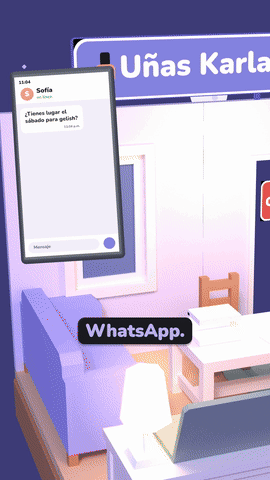
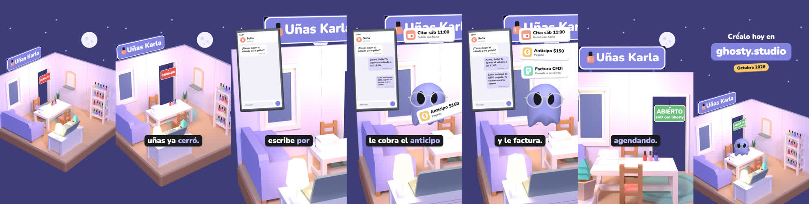

# salon-reel: el salón que no cierra

<p align="center">
  
</p>

<p align="center">
  <em>Ghosty 3D, vertical 1080×1920, 16 s, con narración. Publicado en Instagram el 28 oct 2026.</em>
</p>

Es un diorama low-poly de un salón de uñas, de noche. A las once ya cerró, pero una clienta escribe por WhatsApp.
Ghosty entra volando a la recepción, le da la cita, le cobra el anticipo y le factura. Luego vuela a la puerta y voltea
el letrero de CERRADO a «ABIERTO 24/7 con Ghosty». Todo se hace desde la terminal: Blender headless para el cuarto,
three.js para la escena y numpy para la música.

<p align="center"></p>

## El guion manda

| t | Se ve | Voz |
|---|---|---|
| 0.3 | el salón entero de noche; CERRADO en la puerta | Son las once de la noche y tu salón de uñas ya cerró. |
| 3.75 | la cámara baja a la recepción; sube el celular con el chat | Pero una clienta te escribe por WhatsApp. |
| 6.45 | Ghosty aterriza, contesta; brotan tres tarjetas de la laptop | Ghosty le da la cita, le cobra el anticipo y le factura. |
| 10.2 | Ghosty vuela a la puerta y voltea el letrero | Tu salón cerró, pero Ghosty sigue agendando. |
| 13.4 | el salón entero otra vez + CTA con fecha | Créalo hoy en ghosty.studio. |

La voz (Kokoro `em_santa`, `es-419`, local) se transcribe **frase por frase** y `tools/score.py` convierte las palabras
en momentos: el mensaje llega en «escribe», Ghosty aterriza en «Ghosty», cada tarjeta brota cuando la voz la nombra
y el letrero gira en «sigue». Nada lleva un segundo escrito a mano.

## Cómo se arma

```bash
blender -b -P cuarto/armar.py -- vista      # render rápido para revisar el acomodo
blender -b -P cuarto/armar.py -- hornear    # luz global horneada a una textura de 4096 + cuarto.glb
python3 -m http.server 8787                 # desde la carpeta que contiene salon-reel/ y _shared/
node short/render.mjs 16.2 renders/mudo.mp4 # Chrome headless, cuadro por cuadro a 30 fps → ffmpeg
./short/mix.sh                              # voz + música + efectos, y verificación del entregado
```

**El cuarto se hornea, no se ilumina en vivo.** `armar.py` acomoda muebles del Kenney Furniture Kit (CC0). Los frascos
de esmalte y la lámpara UV son primitivas con bisel. Cycles hornea luz global y sombras suaves a una sola textura, y
three.js la pinta con `MeshBasicMaterial`: se ve como render de Blender y corre a 30 fps en swiftshader, sin que nada
parpadee. Las plantas y la pantalla de la lámpara se separan como nodos `anim_*` con el pivote en su base para que se
mezan. Un gotcha: en el `wall` de Kenney la cara grande es el material `metalDark`, así que si no se pinta, el muro
sale café.

**Encuadre con desplazamiento de lente.** `camera.setViewOffset` pone el punto de mira en un pixel elegido sin girar la
cámara. Ghosty cae abajo a la derecha, el celular a la izquierda y las tarjetas arriba, y nada tapa los subtítulos
(y 1270). Las llaves de cámara son polares con Hermite, y `hold` deja la tangente en cero para que no rebote.

**Lo que flota va anclado a la cámara.** El celular y las tarjetas se colocan con `atScreen(px, py, d)` (unproject) y
se escalan en pixeles con `pxPerM(d)`. Así su tamaño en pantalla es exacto en cualquier toma. Las tarjetas arrancan
en la laptop proyectada a pantalla, y su ancho sale de `measureText`.

**Ghosty actúa, no sólo aparece.**
- Entra en curva desde arriba y se asienta rígido, con un seno amortiguado y sin aplastarse.
- Cabecea con cada entrega, brinca con el «gracias» y vuela a la puerta a empujar el letrero.
- En vuelo se ladea hacia donde va y la mirada sigue la velocidad.
- Nunca da la espalda: el giro en Y siempre apunta a la cámara.

El personaje es el Ghosty 3D oficial, sacado del vector de la marca, con lentes con volumen, mica de vidrio y chapitas
pegadas a la piel. La mica refleja un entorno propio, oscuro y con una sola ventana: con un RoomEnvironment y la cámara
desde arriba, el techo blanco la dejaba lechosa. El módulo `ghosty3d.js` no está en este repo; la escena lo importa de
`../../_shared/ghosty-3d/`.

## La música: por qué suena «a la medida»

`short/synth.py` escribe la cama en numpy, con 48 kHz y siempre el mismo resultado. No usa samples, ni catálogo, ni
modelo generativo. Queda bien porque **la forma la dicta la narración**: lee los mismos tiempos de la voz que mueven
la animación, y cada capa entra en un momento de la historia.

| Momento (de `score.json`) | Qué entra |
|---|---|
| 0 s | sólo el arpegio de piano eléctrico: la noche, el salón cerrado |
| `phoneIn` (la clienta) | el bajo, en el tiempo y su octava en el «y» del cuatro |
| `ghostyIn` (Ghosty) | bombo en el 1 y el 3, shaker en los contratiempos: se pone a trabajar |
| `ctaIn` (el CTA) | un acorde sostenido con su bombo, que dura hasta el último cuadro |

Los timbres son fórmulas cortas:

- **Piano eléctrico:** seno, más un segundo armónico que se apaga en 0.25 s, un tercero muy corto, trémolo de 5 Hz y
  6 ms de ataque.
- **Bajo:** seno con un 30 % de octava.
- **Bombo:** seno que cae de 128 a 48 Hz en 30 ms.
- **Shaker:** 50 ms de ruido derivado, un pasaaltas barato.

La progresión es Fa–La menor–Re menor–Si bemol a 92 BPM, en arpegio de octavos con paneo alterno. Para la siguiente
pista basta cambiar progresión, BPM y timbre.

Los efectos se colocan en el mismo script (`CUES`), cada uno en el cuadro de su animación y nunca el mismo dos veces
seguidas: whoosh al subir el celular, notificación al llegar el mensaje, whoosh y aterrizaje de Ghosty, «enviado» al
contestar, carta, moneda y sello para las tres tarjetas, y vuelta al voltear el letrero.

## La mezcla

`short/mix.sh`:

- Voz a −15 LUFS.
- Cama a −26 LUFS, con `sidechaincompress` cuya llave es la voz sola: se agacha cada vez que alguien habla.
- Efectos al 0.7.
- `amix` con `normalize=0` y `apad` en cada entrada, nunca `-shortest`.
- Ganancia fija medida con `ebur128` y después `alimiter` con `level=false`. En ffmpeg 9 el auto-nivel viene encendido
  y sube todo solo.
- Nunca `loudnorm` al final.

Al terminar verifica sobre el archivo entregado: `start_time` 0, `blackdetect` sin tramos, LUFS integrado y RMS por
ventana. Este salió a −15.2 LUFS, sin cuadros negros, y la transcripción coincide con el guion.

## Lo que no está versionado

`cuarto/cuarto.png` (8.6 MB) y `cuarto.glb` se regeneran con `armar.py -- hornear`. Los WAV de voz se regeneran con
`tools/gen.py`, que necesita Kokoro local y el léxico de la casa. El módulo `ghosty3d.js` y los efectos de la casa
viven fuera del repo. El MP4 está publicado en Instagram.

Créditos: muebles Kenney Furniture Kit (CC0); efectos CC0 de Freesound y propios; música original.
